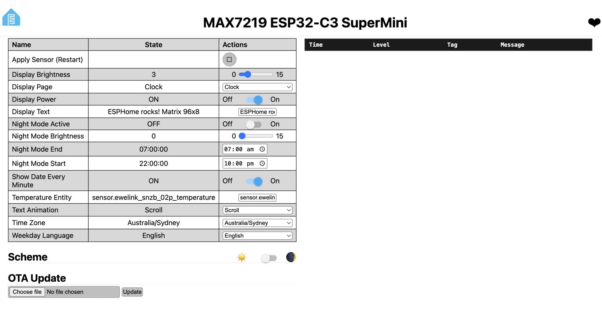

# 🕒 ESP32 MAX7219 Smart Matrix Clock (96×8 Pixels)

A smart 96×8 LED matrix clock built with an ESP32 and ESPHome, fully integrated with Home Assistant.

This is an English documentation fork of [OlLiLe18's original project](https://github.com/OlLiLe18/ESP32-max7219-Matrix-Clock). The README and configuration comments are in English. The configuration includes the ESPHome compatibility and display fixes described in the [validation notes](./ESPHOME_VALIDATION.md).

.png>)

---

## ✨ Features

- ⏰ **Large time display:** Easy-to-read digits with a bold, double-drawn blinking colon.
- 📅 **Date display:** Automatically shows the date as `DD.MM.YYYY`, with a weekday and calendar icon at seconds `:50`–`:55` of each minute.
- 🌡️ **Home Assistant integration:** Displays live outdoor temperature from a Home Assistant sensor.
- ⚙️ **Saved device settings:** Choose the time zone, weekday language, and temperature entity after installation from Home Assistant or the device web page.
- 👾 **Expressive and retro icons:** Animated 8×8 pixel art, including a pulsing heart, Pac-Man, Space Invader, steaming coffee cup, and sun.
- 🌙 **Automatic night mode:** Adjustable start and end times and brightness, including a blank display at night brightness `0`.
- 📜 **Scrolling text mode:** Scroll, Bounce, and Wipe animations for custom messages from Home Assistant.

---

## 🔌 Hardware and ESP32 Pin Connections

The display uses a chain of 12 MAX7219 8×8 modules, giving a total resolution of 96×8 pixels. Use a regulated 5 V supply sized for the display chain and share ground with the ESP32. Confirm the modules' logic-level requirements when wiring the hardware.

| ESP32 pin  | MAX7219 display module | Description      |
| ---------- | ---------------------- | ---------------- |
| `5V / VIN` | `VCC`                  | 5 V power supply |
| `GND`      | `GND`                  | Ground           |
| `GPIO26`   | `CLK`                  | SPI clock        |
| `GPIO27`   | `DIN / MOSI`           | SPI data         |
| `GPIO25`   | `CS / LOAD`            | Chip select      |

### Alternative Device: ESP32-C3 SuperMini

The ESP32-C3 SuperMini is an alternative to the classic ESP32. Use [`max7219-esp32c3-supermini.yaml`](./max7219-esp32c3-supermini.yaml) for this board. The configuration, including runtime settings, compiles successfully with ESPHome `2026.9.1`. **Physical hardware testing remains pending**; see the [validation notes](./ESPHOME_VALIDATION.md) for the software checks and their limits.

The C3 configuration includes the original clock YAML as an [ESPHome package](https://esphome.io/components/packages/) and overrides the processor, device name, display pins, USB logging, and fallback hotspot name. It retains the same 12-module display, fonts, animations, and Home Assistant controls. The generic `esp32-c3-devkitm-1` build target assumes a typical 4 MB SuperMini; check the flash size and pin labels on your board. Arduino is supported on the C3; a framework migration is not required. See the [ESPHome ESP32 documentation](https://esphome.io/components/esp32/).

| ESP32-C3 SuperMini connection | MAX7219 connection | Description |
| ---------------------------- | ------------------ | ----------- |
| `GPIO6` | `CLK` | SPI clock, through level buffer |
| `GPIO7` | `DIN / MOSI` | SPI data, through level buffer |
| `GPIO10` | `CS / LOAD` | Chip select, through level buffer |
| `GND` | `GND` | Shared ground with the display supply |
| External regulated `5 V` supply | `VCC` | Power the matrix directly |

The original GPIO25/26/27 assignments cannot be used on the C3. The replacement pins avoid boot strapping GPIO2/8/9 and native USB GPIO18/19. See [Espressif's GPIO restrictions](https://docs.espressif.com/projects/esp-idf/en/stable/esp32c3/api-reference/peripherals/gpio.html).

**Power and signal levels:** size the 5 V supply for the complete display chain and avoid routing its current through the SuperMini. For the first test, the SuperMini can be powered separately over USB with its ground connected to the display ground. Unless your matrix already includes level conversion, buffer all three signals from 3.3 V to 5 V, for example with a [74AHCT125](https://www.ti.com/product/SN74AHCT125) powered at 5 V, with the used output-enable inputs held low and a 100 nF bypass capacitor across its supply. The [MAX7219 datasheet](https://www.analog.com/media/en/technical-documentation/data-sheets/MAX7219-MAX7221.pdf) specifies a minimum logic-high input of 3.5 V; direct 3.3 V drive is outside that guarantee.

To install on the C3:

1. Copy **both** device YAML files, [`clock_settings.h`](./clock_settings.h), and the `fonts/` directory into `/config/esphome/`, keeping the filenames and relative paths intact. The C3 file depends on the shared YAML and header; do not paste the C3 file alone without them. Use ESPHome **2026.9.1 or newer**.
2. Configure `secrets.yaml` as described below. After installation, choose the time zone and temperature entity using the [saved device controls](#changing-time-zone-and-temperature-while-running). Both board configurations provide these controls; the initial time zone remains `Europe/Berlin`.
3. Open or create the device named `max7219-esp32c3-supermini` in Device Builder and use the contents of the C3 file. Select this device for validation, compilation, and installation. The classic ESP32 firmware cannot be reused on the C3.
4. Flash over USB for the first installation. If it fails to connect, hold **BOOT**, press and release **RESET**, then release **BOOT** and retry. If the board remains in download mode after flashing, press **RESET** again without holding **BOOT**. See [Espressif's boot instructions](https://docs.espressif.com/projects/esptool/en/latest/esp32c3/advanced-topics/boot-mode-selection.html).
5. Check USB logs, Wi-Fi, Home Assistant connectivity, display orientation, clock/date/temperature, text modes, brightness, and night blanking. Test a cold start from the intended power supply and an OTA update after Wi-Fi is working.

The alternative configuration explicitly selects native `USB_SERIAL_JTAG` logging, which [ESPHome supports on the C3](https://esphome.io/components/logger/). Validate and compile with your own credentials before flashing:

```sh
esphome config max7219-esp32c3-supermini.yaml
esphome compile max7219-esp32c3-supermini.yaml
```

---

## Changing Time Zone and Temperature While Running

After installing this firmware, open the clock's device page in Home Assistant and look under **Configuration**, or visit `http://<clock-ip>/` in a browser. These controls are shared by the classic ESP32 and C3 configurations:

| Control | How to use it |
| ------- | ------------- |
| **Time Zone** | Choose a zone such as `Australia/Sydney`. It applies immediately to the clock, date, and night schedule, with daylight-saving rules where applicable. |
| **Weekday Language** | Select **German** (default: `SO MO DI MI DO FR SA`) or **English** (`SU MO TU WE TH FR SA`), listed Sunday through Saturday. It applies on the next display frame, without restarting. |
| **Temperature Entity** | Enter the full Home Assistant entity ID, for example `sensor.outdoor_temperature`, and save/submit the field. |
| **Apply Sensor (Restart)** | After saving the entity, press this button. It saves pending settings and restarts the clock to subscribe to that sensor. |



*Web UI on the ESP32-C3 SuperMini, with `Australia/Sydney` and English weekdays selected. Open the image to view the controls at full size.*

The temperature field is a text input; copy the entity ID from Home Assistant's States tool. Use a numeric `sensor.…` entity, up to 100 characters, whose state contains the temperature itself. The device must be connected to Home Assistant through the ESPHome integration to receive updates. Until you apply the sensor setting, the previous source remains active. Missing or nonnumeric readings display `--.-°`. Invalid entity names prevent the apply button from restarting; check the ESPHome logs if it does not restart.

Settings restore after a normal restart. ESPHome normally batches flash writes, so allow about a minute before removing power after changing the time zone or weekday language. **Apply Sensor (Restart)** explicitly flushes pending writes before restarting. No YAML editing or firmware rebuild is needed for these controls after the initial firmware update.

The time-zone dropdown supports UTC; Sydney, Melbourne, Brisbane, Adelaide, Darwin, Perth, Hobart, and Lord Howe; Auckland; Berlin and London; New York, Chicago, Denver, and Los Angeles; Tokyo, Singapore, and Kolkata. Adding another zone or updating its rules requires a firmware change to the dropdown and `clock_settings.h`.

For first-boot defaults only, optionally edit `default_timezone` and `default_temperature_entity` under `substitutions:` at the top of `max7219-esp32-reg.yaml`. Saved device settings take precedence over those defaults on later boots. Leave the SNTP component's `timezone: "UTC"` entry as supplied; the **Time Zone** control applies the selected local zone.

To upgrade an existing clock, copy the updated shared YAML and `clock_settings.h` into the ESPHome folder, preserve your existing `!secret` name adjustments, then compile/install the appropriate device configuration once over OTA. Existing firmware will not show these new controls until it is updated.

---

## 💖 Support the Original Author

Enjoying the project? [Buy the original author, OlLiLe18, a coffee via PayPal](https://www.paypal.com/donate/?hosted_button_id=R3GX3HE8RF4LW).

---

## 🚀 Installation with ESPHome Device Builder

Use the ESPHome dashboard in Home Assistant to set up the clock. The steps below use the classic ESP32 configuration; for the C3, follow the [alternative device instructions](#alternative-device-esp32-c3-supermini) above.

### 1. Install the Fonts and Settings Header

Download `basis33.ttf` and `pixelmix.ttf` from the [`fonts/`](./fonts/) directory and copy them to `/config/esphome/fonts/` in your Home Assistant filesystem. You can use the File Editor, Studio Code Server, or Samba Share add-on to copy the files.

Also copy [`clock_settings.h`](./clock_settings.h) beside the device YAML, at `/config/esphome/clock_settings.h`. The configuration requires ESPHome **2026.9.1 or newer**.

### 2. Set Up Wi-Fi and Credentials

If you do not already have an ESPHome `secrets.yaml`, copy [`secrets.example.yaml`](./secrets.example.yaml) to `secrets.yaml` beside the device YAML and replace every example value. If you already have one, keep it and use its existing secret names as described below; add only the credentials that are missing. Open **Secrets** in the ESPHome dashboard to edit that file (depending on the dashboard version, this may be in the three-dot menu **⋮**).

The supplied configuration uses `wifi_ssid`, `wifi_password`, `api_encryption_key`, `ota_password`, and `fallback_ap_password`. If you need a new API encryption key, generate one using:

```sh
openssl rand -base64 32
```

The device YAML reads these values using `!secret`. Keep `secrets.yaml` private; it is excluded from Git. The API key example intentionally requires replacement before validation or installation.

#### Using an Existing ESPHome Secrets File

**Use the names already defined in your ESPHome `secrets.yaml`.** Update the corresponding `!secret` references in `max7219-esp32-reg.yaml` to match those names exactly, including case. These references also apply to the C3 configuration because it includes that file. Preserve existing entries used by other devices.

For example, if your existing secrets file defines `esphome_encryption_key`, change the clock's API configuration from `key: !secret api_encryption_key` to:

```yaml
api:
  encryption:
    key: !secret esphome_encryption_key
```

Keep your existing valid key value in `secrets.yaml`; you do not need to rename or duplicate it. Apply the same matching rule to Wi-Fi SSID/password, OTA password, and fallback hotspot password references. Choose entries that contain the appropriate credential for each setting, and add a new secret only where one is needed.

#### Folder Layout and Missing Secrets

Some Home Assistant editors show the configuration directory as `homeassistant/`. If your files appear under `homeassistant/esphome/` and ESPHome logs show `/config/esphome/`, use the ESPHome folder identified by those logs. For the C3, the layout should be:

```text
homeassistant/esphome/          # ESPHome sees this as /config/esphome/
├── max7219-esp32c3-supermini.yaml
├── max7219-esp32-reg.yaml
├── clock_settings.h
├── secrets.yaml
└── fonts/
    ├── basis33.ttf
    └── pixelmix.ttf
```

An error such as `Error including file 'max7219-esp32-reg.yaml': Secret 'api_encryption_key' not defined` means ESPHome found the included YAML but could not resolve that secret. It occurs while reading the configuration, before firmware compilation or upload.

Open ESPHome's **Secrets** editor, or edit `homeassistant/esphome/secrets.yaml`, and ensure every `!secret` reference in the device configuration matches an entry in that file. If your existing secret uses a different name, update the reference as described above. The names are case-sensitive and must be top-level keys, without an enclosing `api:`, `wifi:`, or `secrets:` section. For a new secrets file using the template names, the encryption entry is `api_encryption_key: "YOUR_GENERATED_KEY"`; replace `YOUR_GENERATED_KEY` with the output of `openssl rand -base64 32` above, or the encryption key generated by the ESPHome device wizard.

Uploading only `secrets.example.yaml` does not configure secrets. The file must be named `secrets.yaml` in the ESPHome folder; `homeassistant/secrets.yaml` at the parent level is a separate Home Assistant secrets file and is not automatically used here. Save the ESPHome secrets file, then validate or install `max7219-esp32c3-supermini.yaml` again. See [ESPHome's secrets documentation](https://esphome.io/guides/yaml/).

### 3. Create the Device and Paste the YAML

1. In the ESPHome dashboard, click **+ New Device** or **Create Device**.
2. Click **Continue** and enter the device name exactly as `max7219-esp32-reg`. The [original setup screenshot](<Konfiguration erstellen ESPHome Builder – Home Assistant.png>) shows this step in German.
3. Select **ESP32** as the platform.
4. Complete the wizard using **Skip** or **Finish**, as appropriate.
5. Find the new device card and click **Edit**.
6. Replace the generated configuration with the complete contents of [`max7219-esp32-reg.yaml`](./max7219-esp32-reg.yaml).
7. Confirm that the credentials from step 2 are present in the ESPHome `secrets.yaml` file. Keep the `!secret` references in the device configuration.
8. Optionally set the initial `default_timezone` and `default_temperature_entity` values under `substitutions:`. You can also choose them after installation using the saved device controls above.
9. Review the configuration, then click **Save** and **Close**.

The initial time zone is `Europe/Berlin`; choose your location, for example `Australia/Sydney`, using **Time Zone** after installation. Weekday abbreviations default to German; choose **English** in **Weekday Language** for `SU MO TU WE TH FR SA`. The numeric date format remains `DD.MM.YYYY` in both languages.

### 4. Install the Firmware

Open the new device card's three-dot menu **⋮** and select **Install**. Choose **Plug into this computer** for the first installation over USB, or **Wirelessly** / **Over the air (OTA)** for later updates over Wi-Fi.

For browser-based USB flashing, use [ESPHome Web](https://web.esphome.io/).

---

## ESPHome Verification

See [the validation notes](./ESPHOME_VALIDATION.md) for the tested ESPHome version, fixes, software checks, and the checks that still need physical hardware.

To validate and compile after entering your own credentials:

```sh
esphome config max7219-esp32-reg.yaml
esphome compile max7219-esp32-reg.yaml
```

To run the display logic checks on a computer with Python 3 and `clang++` or `g++`:

```sh
python3 scripts/check_display_logic.py
```

In an ESPHome 2026.9.1+ Python environment, also run the runtime settings checks:

```sh
python3 scripts/check_runtime_settings.py
```

These compare the actual timezone helper and ESPHome converter with Python's timezone database, and exercise the sensor binding and apply/restart lambdas without hardware.

## Fork Changes and Contributing Upstream

See the [changes since the fork](./docs/FORK_CHANGES.md) for the firmware fixes, C3 support, runtime controls, date/language changes, and validation limits. To propose these changes to the original project, follow the [first pull request guide](./docs/PULL_REQUEST_GUIDE.md) and use the [suggested PR title and description](./docs/PULL_REQUEST_DESCRIPTION.md).
